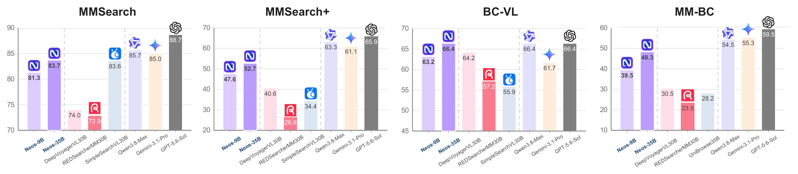

<h1 align="center">
  
  Neos: Learning to Interleave Search and Visual Reasoning
</h1>

<p align="center">
  <a name="project-page-badge" href="https://accio-lab.github.io/Neos/"></a>
  <a name="arxiv-badge" href="https://arxiv.org/abs/2610.17043"></a>
  <a name="dataset-badge"></a>
  <a name="model-badge"></a>
  <a name="citation-badge"></a>
</p>

## 🧭 Overview

Neos learns both **how to acquire evidence** and **how to use it to guide subsequent search**. It closes the evidence–decision loop through three complementary innovations:

- **Evidence-dependent task synthesis:** constructs tasks with intermediate visual dependencies and filters textual shortcuts, making newly acquired visual evidence necessary for later search decisions.
- **Reference-guided credit assignment:** uses verified successful trajectories to localize critical errors and their downstream consequences, while preserving credit for productive and corrective decisions in failed searches.
- **Agent–environment co-evolution:** embeds a lightweight, trainable **Multimodal Evidence Interface (MEI)** in the tools and alternates policy RL with MEI SFT, so evidence presentation and search behavior adapt to each other.

**Neos-9B** and **Neos-35B** use Qwen3.5-9B and Qwen3.5-35B-A3B as policy backbones. Across ten benchmarks, the preprint reports average scores of **60.7** and **64.9**, improving over their respective base workflows by **17.4** and **15.7 points**.



## 🔔 Timeline

- **2026-10-10:** Released our training and inference code.

## ⚙️ Configuration

```bash
cd Neos
cp config.example.json config.local.json
```

Edit **`Neos/config.local.json`** to configure paths, APIs, and cluster hosts. All scripts load this file automatically.

## 🛠️ Environment

Requires Linux x86_64, Python 3.12, CUDA Toolkit 12.9, and a C++ compiler.

```bash
bash environment/setup.sh
```

All following commands run from `Neos/`.

## 🚀 Training

### 🎯 SFT

Choose the required training entrypoint:

```bash
bash scripts/train_policy_9b.sh
bash scripts/train_policy_35b.sh
bash scripts/train_mei.sh
```

### 🔄 RL co-evolution

Prepare the configured RL data once:

```bash
bash scripts/prepare_rl_data.sh
```

Run each role on its corresponding host, using the same configuration:

```bash
bash scripts/train_coev_35b.sh mei
bash scripts/train_coev_35b.sh 0
bash scripts/train_coev_35b.sh 1
bash scripts/train_coev_35b.sh 2
bash scripts/train_coev_35b.sh 3
```

For 9B, replace `train_coev_35b.sh` with `train_coev_9b.sh`. All roles share a default run name; optional `--run-id` separates experiments.

### 📦 Model export

Set the checkpoint and destination fields in `config.local.json`, then select the target:

```bash
bash scripts/export_model.sh --target policy-9b
bash scripts/export_model.sh --target policy-35b
bash scripts/export_model.sh --target mei
```

## 📊 Evaluation

Start MEI and Policy services on their respective machines:

```bash
bash scripts/serve_mei.sh
bash scripts/serve_policy.sh
```

For cross-node MEI access, use `--host` to bind a private interface and set `NEOS_LOCAL_MEI_ENDPOINT` accordingly. Set `NEOS_EVAL_MODEL_SPEC` to the Policy service, using the form `http://<policy-host>:62080/v1:neos-policy`.

```bash
bash scripts/evaluate.sh --bench all10 --interleave-benchmarks
```

Replace `all10` with a benchmark such as `browsecomp_vl`, `mm_browsecomp`, or `vdr` to run it individually. A new output directory is created automatically and printed at startup. To resume, pass `--out` with that directory, or reuse an explicit `--run-id`.

## 📚 Citation

```bibtex
@misc{he2026neos,
  title         = {Neos: Learning to Interleave Search and Visual Reasoning},
  author        = {Ekko He and Jack Hong and Shilin Yan and Xintong Zhang
                   and Yujie Zhang and Wenjie Li and Haoran Sun and Kaixun Jiang
                   and Jiyuan Fu and Guannan Zhang and Hongwei Xue},
  year          = {2026},
  eprint        = {},
  archivePrefix = {arXiv},
  url           = {}
}
```

## 📄 License

Neos original code is licensed under the [Apache License 2.0](LICENSE). Third-party components retain their respective licenses.
